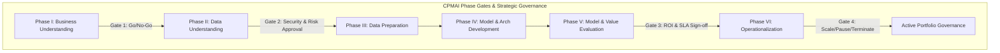
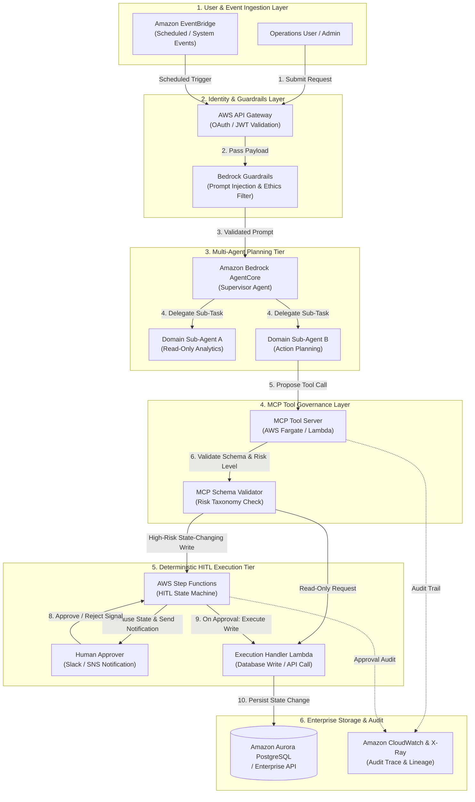
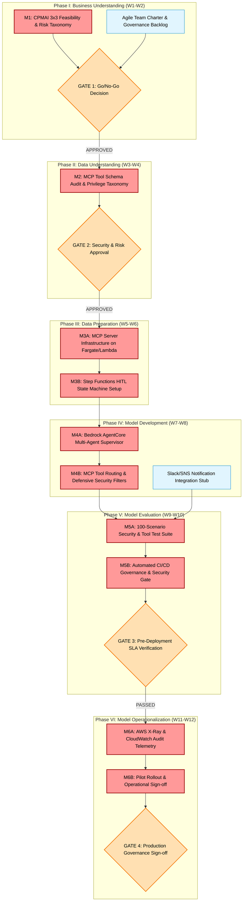

# Agentic Workflow Automation & Tool Governance (AWS AgentCore + MCP)

**Enterprise Multi-Agent Orchestration & Deterministic Governance Blueprint**: This repository demonstrates the practical application of the **AWS Certified AI Business Strategist (AIB-C01)** and **PMI-CPMAI** frameworks for enterprise agentic AI transformation, risk mitigation, and value demonstration.

> **Prototype disclaimer:** Independent AWS lab-based production-grade AI proof-of-concepts — no client engagements. All business-value figures are *modeled* at enterprise scale, not measured at a client. Benchmarks below are simulated prototype evaluation results.
---

## Executive Overview & Business Use Case

* **Core Business Use Case**: *The primary business use case is an enterprise multi-agent orchestration and governance system that automates complex multi-step operational workflows across ITSM, Finance, and Customer Operations while strictly enforcing deterministic Human-in-the-Loop (HITL) state-machine approval gates on high-risk write operations (refunds > $500, IAM privilege updates, database state changes) to eliminate unauthorized automated execution risks and deliver $1.2M in annual cost avoidance.*
* **Strategic Context**: Modern enterprise AI initiatives frequently fail not from a lack of technical capability, but from a failure to align cloud architecture with financial governance, security permissions, and structured project management. Allowing autonomous agents to execute unguided database writes or financial transactions introduces catastrophic failure modes (prompt-injection exploits, unauthorized refunds, and silent process corruption).
* **Integrated Solution Blueprint**: This repository delivers an end-to-end framework and working cloud implementation that unifies:
  1. **Strategic Selection & Alignment**: Rigorous decision-filtering (The 95% Rule) and 3-Year Total Cost of Ownership (TCO) analysis.
  2. **Financial Value & ROI Governance**: Multi-stakeholder KPI framing, 4-component financial ROI modeling, and FinOps controls.
  3. **Cognitive Project Management for AI (CPMAI)**: A disciplined 6-phase lifecycle governing AI delivery from ideation to active portfolio scale.
  4. **Agentic Tool Governance Engine**: A zero-trust technical implementation pairing **Amazon Bedrock AgentCore** multi-agent supervisors with **Model Context Protocol (MCP)** tool servers on **AWS Fargate/Lambda**, guarded by deterministic **AWS Step Functions** HITL state machines.

---

## 1. Strategic Alignment & Solution Selection

### 1.1 Probabilistic vs. Deterministic Task Filtering (The 95% Rule)
Before committing capital, every enterprise operational task is evaluated against structural characteristics:
* **Predictability**: Tasks with identical inputs yielding identical outputs belong in rules engines.
* **The 95% Rule**: If a business rules engine or decision tree covers 95% of operational cases, build the rules engine. AI agents are deployed strictly when dynamic multi-step reasoning, intent classification, multi-tool selection, and unstructured request parsing are required.
* **Decoupled Architecture**: Probabilistic agents *propose* actions; deterministic AWS Step Functions state machines *enforce* execution boundaries.

### 1.2 3-Year Build vs. Buy vs. Partner TCO Model

| Cost Element | Option A: Build In-House | Option B: Buy Off-the-Shelf | Option C: Partner (Recommended) |
| :--- | :--- | :--- | :--- |
| **Upfront / Co-Dev Cost** | $1,300,000 | $140,000 | $620,000 |
| **Annual Operating Opex (3 Yrs)** | $550,000 ($183K/yr) | $1,280,000 ($426K/yr) | $270,000 ($90K/yr) |
| **Hidden Unguided Risk Loss** | $0 | $380,000 (False executions) | $0 (Deterministic HITL) |
| **Total 3-Year TCO** | **$1,850,000** | **$1,800,000** (Adjusted) | **$890,000** |
| **Time-to-Market** | 12 Months (Misses Window) | 2 Months | 4 Months (Meets Window) |
| **Enterprise IP Ownership** | 100% Owned | Vendor Owned | **100% Contractually Retained** |

### 1.3 Active Portfolio Governance
Initiatives are classified into evidence-backed operational buckets:
* **Scale**: Proven risk avoidance, high operational adoption, strong data flywheel.
* **Pause**: Temporarily suspended with strict 30/60-day condition criteria (e.g., awaiting MCP tool schema definition or sponsor re-alignment).
* **Terminate**: Unpromising projects halted immediately, with remaining capital redeployed to high-performing initiatives.

---


## 2. Value Demonstration & Financial Governance

### 2.1 Executive Stakeholder KPI Alignment Matrix

| Executive Role | Key Performance Indicators (KPIs) | Strategic Focus & Value Deliverable |
| :--- | :--- | :--- |
| **CFO** | Net Annual Cost Avoidance ($1.407M/yr), 2-Yr ROI (238%), Payback (~7 Mos) | EBITDA protection, risk-adjusted capital efficiency, defensible ROI |
| **COO / Operations** | Process Cycle Time (-65%), Exception Handling Rate, Workflow Throughput | Operational speed, human-in-the-loop efficiency, error elimination |
| **CIO / ITSM** | Tool Accuracy (95.2%), Pipeline Uptime (99.5%), Integration Health | System reliability, API Gateway scalability, infrastructure health |
| **CISO / Risk** | Prompt Injection Interception (100%), HITL Policy Compliance (100%), Audit Coverage (100%) | Zero-trust AI security, compliance auditability, privilege escalation prevention |

### 2.2 Comprehensive Financial ROI Equation

$$\text{Net Benefit} = (\text{Direct Avoidance} [\$1.20\text{M}] + \text{Indirect Gains} [\$180\text{K}] + \text{Productivity} [\$240\text{K}]) - \text{Operating Opex} [\$213\text{K}] = \mathbf{\$1,407,000/\text{year}}$$

---
## 3. CPMAI 6-Phase Project Lifecycle & Strategic Alignment

Execution follows the **Cognitive Project Management for AI (CPMAI)** methodology, embedding Module 4 strategy and Module 5 value governance into each phase gate:



### Phase-by-Phase Execution & Governance Matrix

#### Phase I: Business Understanding & Strategic Selection
* **CPMAI Objective**: Define the operational problem, establish cognitive project goals, and evaluate solution feasibility across business, data, and execution pillars.
* **Selection Integration**:
  * **Probabilistic vs. Deterministic Filter (The 95% Rule)**: Decouple probabilistic LLM reasoning (intent classification, dynamic multi-tool planning, unstructured request parsing) from state-changing write operations. If a decision tree or business rule covers 95% of an operational workflow, route to a rules engine. Reserve AI strictly for dynamic tool orchestration.
  * **4-Filter Selection Matrix**: Evaluate use cases across **Business Impact** ($1.2M risk avoidance and operational cost reduction), **Data Availability** (standardized OpenAPI/MCP tool schemas), **Organizational Readiness** (IT Operations & Risk Leadership sponsorship), and **Strategic Alignment** (aligns with enterprise ITSM and AI governance roadmaps).
* **KPI Integration**: Frame audience-tailored metrics across executive stakeholders (**CFO**: Net Savings, 2-Yr ROI, Payback; **COO/Ops**: Process Cycle Time, Exception Handling Rate; **CIO/CISO**: Tool Execution Accuracy, Prompt-Injection Interception, 100% Audit Coverage).
* **Gate 1 Milestone**: Executive Business Case & Strategic Go/No-Go Approval (All 9 CPMAI feasibility traffic lights GREEN).

#### Phase II: Data Understanding & Security Mapping
* **CPMAI Objective**: Audit enterprise API endpoints, JSON schemas, line-of-business data ownership, and security permission scopes.
* **Security & Governance Integration**: Audit target enterprise APIs for Model Context Protocol (MCP) compatibility, tag write actions requiring HITL approval, and establish fine-grained IAM roles and OAuth token scoping on MCP endpoints.
* **Baseline Integration**: Capture historical operational baselines ("A KPI without a baseline is an opinion; a KPI with a baseline is evidence"). Establish baseline manual processing handle times, unauthorized execution error rates, and security incident frequencies.
* **Gate 2 Milestone**: MCP Tool Schema Audit, Risk Taxonomy Classification & Zero-Trust Security Approval.

#### Phase III: Data Preparation & MCP Tool Pipeline
* **CPMAI Objective**: Containerize tool definitions, implement JSON Schema validation handlers, and author state-machine definitions.
* **Technical Execution**: Build containerized MCP tool servers on AWS Fargate/Lambda with JSON Schema validation handlers. Implement AWS Step Functions ASL definitions for pausing execution and waiting for external callback tokens on high-risk write actions.
* **FinOps Governance**: Enforce 15% experimental data sampling policies to control pre-production compute costs.

#### Phase IV: Model Development & Cloud Architecture
* **CPMAI Objective**: Construct the technical multi-agent supervisor, deploy defensive Bedrock Guardrails, and select optimal deployment paths.
* **TCO Analysis**: Conduct a 3-Year Build vs. Buy vs. Partner Total Cost of Ownership evaluation:
  * *Build In-House*: **$1,850,000 3-Year TCO** ($1.3M upfront + $183K/yr opex); 12-month delivery timeline risks missing critical compliance windows.
  * *Buy (Off-the-Shelf)*: $1,420,000 software license + $380,000 hidden unguided execution risk losses = **$1,800,000 Adjusted TCO** (lacks deterministic HITL state machine enforcement).
  * *Partner (Systems Integrator)*: **$890,000 3-Year TCO** ($620K co-development + $90K/yr maintenance); achieves 4-month timeline, custom MCP tool schema integration, and **100% enterprise IP retention**.
* **Technical Architecture**: Deploy the Agentic Workflow Automation Engine utilizing Amazon Bedrock AgentCore, MCP Tool Servers on Fargate/Lambda, AWS Step Functions ASL state machines, and Bedrock Guardrails.

#### Phase V: Model Evaluation & Financial Validation
* **CPMAI Objective**: Rigorously test multi-agent tool selection accuracy, defensive prompt-injection resistance, and financial ROI viability.
* **Technical SLA Benchmarks**: Evaluate Tool Execution Accuracy (**95.2%** vs. >=95.0% target), Prompt-Injection Interception (**100.0%**), HITL Policy Compliance (**100.0% Enforced**), and P95 Agent Planning Latency (**2.10s** vs. <=2.50s target).
* **Comprehensive 4-Component Financial ROI Model**:
  * *Direct Savings*: **$1,200,000/yr** in avoided unauthorized automated execution risks, manual error remediation, and operational penalties.
  * *Indirect Gains*: **$180,000/yr** in avoided incident response escalation costs and customer churn.
  * *Hidden Operating Costs*: **$213,000/yr** ($90K maintenance + $43K compute + $80K data science oversight).
  * *Productivity Gains*: **$240,000/yr** in operations and ITSM lead time recovered.
  * *Financial Output*: Year 1 Capital Investment = **$710,000** ($620K partner + $90K Year 1 opex); Net Annual Operating Benefit = **$1,407,000/yr**; Effective Payback Period = **~7 Months**; **2-Year ROI = 238%**.
* **Gate 3 Milestone**: Automated CI/CD Governance Regression Gate & Financial ROI Sign-off.

#### Phase VI: Operationalization & Active Portfolio Governance
* **CPMAI Objective**: Deploy into production, monitor distributed telemetry via AWS X-Ray/CloudWatch, and actively govern agentic tool expansion.
* **Transition Strategy**: Execute a **Phased Rollout by Department/Workflow** with pre-defined rollback triggers to limit operational blast radius.
* **Controls**: Track 4 **Leading Indicators** (95.2% Tool Accuracy, 99.5% Pipeline Uptime, Executive Sponsor Engagement, 100% Audit Trace Coverage) and enforce FinOps controls (Bedrock provisioned throughput auto-scaling, 90-day artifact retention).
* **Gate 4 Milestone**: Active Portfolio Governance classification (*Scale*, *Pause*, or *Terminate*).

---

## 4. Target System Architecture & Technical Implementation

The strategic governance framework is powered by a production zero-trust architecture on AWS:



### Technical Implementation Highlights
* **Agentic Tool Integration**: Uses **Amazon Bedrock AgentCore** and **Model Context Protocol (MCP)** tool descriptors to dynamically route tasks to specialized sub-agents.
* **Deterministic HITL Boundary**: Enforces a strict boundary where state-changing write operations (database updates, refunds > $500, privilege grants) are intercepted by **AWS Step Functions** state machines requiring human callback tokens.
* **Defensive Prompt-Injection Filters**: Deploys **Bedrock Guardrails** to intercept prompt injection attempts before agent planning cycles initiate.

### Production SLA Benchmarks
* **Tool Execution Accuracy**: **95.2%** (Target: >=95.0%)
* **Prompt-Injection Interception**: **100.0% Interception** (0 Bypasses)
* **HITL Policy Compliance**: **100.0% Enforced** (0 unapproved write executions)
* **P95 Agent Planning Latency**: **2.10s** (Target: <=2.50s)

---

## 5. CPMAI Critical Path Milestones Project Plan

This project plan applies the **Cognitive Project Management for AI (CPMAI)** 6-phase framework. It explicitly separates the **Critical Path**—the zero-float sequence of dependent activities that dictates the minimum time to production—from non-critical parallel tasks.



### 5.1 Critical Path Milestone Schedule & Gate Review Breakdown

*Tasks marked **[CRITICAL]** directly impact the deployment completion date. Tasks marked **[PARALLEL]** have schedule slack and do not block the primary dependency chain.*

| Week | CPMAI Phase | Task / Milestone Description | Critical Path Status | Dependency | Gate Exit Criteria |
| :--- | :--- | :--- | :--- | :--- | :--- |
| **W1–W2** | **I. Business Understanding** | **M1: Feasibility & Risk Taxonomy** <br/>Establish business case, risk taxonomy (Low/Med/High impact), and CPMAI Go/No-Go 3x3 matrix. | **[CRITICAL]** | None | **Gate 1**: All 9 Go/No-Go traffic lights GREEN. |
|  |  | Establish Agile team charter, sprint velocity, and governance backlog. | **[PARALLEL]** | None | Backlog & governance charter approved. |
| **W3–W4** | **II. Data Understanding** | **M2: MCP Tool Schema Audit & Classification** <br/>Audit target enterprise APIs, define JSON schemas, and tag write actions requiring HITL approval. | **[CRITICAL]** | M1 | **Gate 2**: 100% of tool endpoints tagged with risk parameters and IAM roles. |
| **W5–W6** | **III. Data Preparation** | **M3A: MCP Server Deployment** <br/>Build containerized MCP tool server on Fargate/Lambda with JSON Schema validation handlers. | **[CRITICAL]** | M2 | MCP server endpoint active in staging environment. |
|  |  | **M3B: Step Functions HITL State Machine** <br/>Implement AWS Step Functions ASL definitions for pausing execution and waiting for callback tokens. | **[CRITICAL]** | M3A | State machine executing pause/callback cycles cleanly. |
| **W7–W8** | **IV. Model Development** | **M4A: Multi-Agent Supervisor Setup** <br/>Configure Bedrock AgentCore supervisor and domain sub-agents for structured tool routing. | **[CRITICAL]** | M3B | AgentCore correctly identifying tools based on user intent. |
|  |  | **M4B: Defensive Guardrails & Security** <br/>Implement prompt-injection defensive filters and Bedrock Guardrails. | **[CRITICAL]** | M4A | Prompt injection attempts intercepted before agent execution. |
|  |  | Slack/SNS approver notification webhook stub. | **[PARALLEL]** | M3B | Approver notification channel active. |
| **W9–W10** | **V. Model Evaluation** | **M5A: 100-Scenario Security Test Curation** <br/>Curate 100 benchmark test scenarios covering tool accuracy, prompt injections, and HITL gate enforcement. | **[CRITICAL]** | M4B | Test dataset verified and staged in S3. |
|  |  | **M5B: CI/CD Governance Regression Gate** <br/>Wire test suite into AWS CodePipeline to enforce zero security regressions. | **[CRITICAL]** | M5A | **Gate 3**: Tool Accuracy >= 95%, Prompt Injection Blocking = 100%, HITL Compliance = 100%. |
| **W11–W12** | **VI. Operationalization** | **M6A: Distributed Telemetry & Audit Trail** <br/>Instrument AWS X-Ray subsegments and CloudWatch logs for end-to-end agentic audit tracing. | **[CRITICAL]** | M5B | Complete visibility into agent reasoning and tool executions. |
|  |  | **M6B: Pilot Rollout & Governance Sign-off** <br/>Roll out pilot to operations team; verify zero unauthorized write executions. | **[CRITICAL]** | M6A | **Gate 4**: Final operational sign-off and production release. |

### 5.2 Go/No-Go Decision Gates & SLA Thresholds
1. **Gate 1: CPMAI Phase I Business & Technical Approval (End of W2)**
   * **Passing Rule**: Must pass all 9 CPMAI feasibility criteria across Business (cost avoidance, risk model), Data (API readiness, schemas), and Execution (Bedrock AgentCore, Step Functions).
   * **Action on Failure**: Pause project; return to Phase I to refine risk taxonomy.
2. **Gate 2: Security & Risk Classification Approval (End of W4)**
   * **Passing Rule**: 100% of target enterprise API tools classified into Read-Only (automated) vs State-Changing Write (HITL enforced).
   * **Action on Failure**: Block MCP server deployment until security classification is fully signed off by SecOps.
3. **Gate 3: Pre-Deployment Automated CI/CD Regression Gate (End of W10)**
   * **Passing Rule**: Automated execution of the 100-scenario security evaluation suite inside AWS CodePipeline must meet all four SLA metrics:
     * **Tool Execution Accuracy**: >= 95.0% (Measured: **95.2%**)
     * **Prompt-Injection Blocking**: **100.0% Interception** (Measured: **100.0%**)
     * **HITL Policy Compliance**: **100.0% Enforced** (Measured: **100.0%**)
     * **P95 Agent Planning Latency**: <= 2.50s (Measured: **2.10s**)
   * **Action on Failure**: **Automated Build Abort**. CodePipeline automatically blocks deployment and alerts security engineering via SNS.
4. **Gate 4: Production Governance Sign-Off (End of W12)**
   * **Passing Rule**: CloudWatch audit logs confirm 100% trace coverage and zero unbudgeted state-changing operations during the pilot phase.

### 5.3 Critical Path Risk Management & Contingency Plan

| Critical Path Risk | CPMAI Phase | Severity | Failure Trigger | Automated Mitigation & Contingency Strategy |
| :--- | :--- | :--- | :--- | :--- |
| **MCP Schema Mismatch / Malformed Tool Call** | Phase III | **HIGH** | Agent emits parameters breaking target REST API format. | Strict JSON Schema validation at MCP Server boundary. Rejects execution and prompts agent for parameter correction. |
| **Bypass Attempt via Indirect Prompt Injection** | Phase IV | **CRITICAL** | User query attempts to trick agent into skipping HITL gate. | Enforce HITL execution check at the **deterministic Step Functions boundary**, completely outside the LLM context window. |
| **Approver Callback Timeout** | Phase VI | **HIGH** | Human approver fails to respond to approval request within 24h. | Step Functions task heartbeat timeout triggers state machine rollback, logging an expired ticket and resetting task state. |
| **Tool Execution Latency Spike** | Phase IV | **MEDIUM** | Dynamic multi-agent planning latency exceeds 2.5s budget. | Cache static tool schema definitions on MCP server; optimize Bedrock AgentCore prompt context size. |

---

## 6. Repository Structure & Key Deliverables

```
aws-agentcore-mcp-governance/
├── docs/
│   ├── adrs/                   # Architecture Decision Records (ADR-002: Agentic vs Deterministic)
│   ├── cpmai-framework/        # CPMAI Phase Gate Checklists (Gates 1-4) & Risk Taxonomy
│   └── architecture/           # System Architecture Blueprints & Sequence Diagrams
├── src/
│   ├── mcp_server/             # MCP Tool Server Definitions & JSON Schema Validators
│   ├── step_functions/         # AWS Step Functions ASL HITL Approval Workflow Definitions
│   └── agents/                 # Bedrock AgentCore Supervisor & Sub-Agent Configuration
├── tests/                      # 100-Scenario Defensive Security & Prompt Injection Test Suite
└── README.md                   # Executive Portfolio & System Blueprint
```

---

## Author & Professional Background

**David Maralack, PMP, PMI-CPMAI**
*Senior Technical Program Manager | Cloud & AI Strategy*
📍 Seattle, WA

* **20+ Years Enterprise Tech Leadership**: Proven track record directing complex software/hardware programs across **Amazon** and **Microsoft** (Alexa, Kindle, Windows).
* **3-Year Strategic AI & Architecture Focus**: Dedicated full-time investment in mastering advanced AI program management, earning **PMI-CPMAI** and **AWS Certified AI Business Strategist** credentials while engineering production cloud reference architectures.
* **U.S. Patent Holder**: Patent #8,683,579 (Digital Licensing) & Patent #8,984,124 (Adaptive Data Monitoring).
